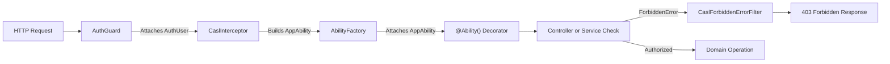

# Authorization with CASL Abilities

This document describes how the application authorizes requests using CASL abilities.

## Context

Protected operations depend on who the caller is and how they relate to the target resource, such as owning a checklist or holding a share. Scattering ad-hoc ownership checks across controllers and services duplicates rules and risks inconsistent enforcement. Centralizing permission rules in one factory keeps access control declarative, consistent, and easy to audit.

## Overview

When an authenticated request arrives, the authorization pipeline builds a request-scoped `AppAbility` from the authenticated user and attaches it to the request. Controllers and services check this ability against domain subjects before completing restricted operations. Failed checks throw `ForbiddenError`, which a global exception filter converts into an HTTP `403 Forbidden` response.

## Building Blocks

### Ability Definition

[`AbilityFactory`](../../src/casl/ability.factory.ts) (tested in [`ability.factory.spec.ts`](../../src/casl/ability.factory.spec.ts)) defines all permission rules in `createForUser(user)`. It builds an `AppAbility` that maps actions (`create`, `read`, `update`, `delete`) to subject types and attribute conditions—for example, restricting [checklist share invitation](../glossary/checklist-share-invitation.glossary.md) management to the checklist creator.

### Request Attachment and Extraction

[`AuthGuard`](../../src/auth/auth.guard.ts) verifies the bearer token and attaches an `AuthUser` to the request. [`CaslInterceptor`](../../src/casl/casl.interceptor.ts) (tested in [`casl.interceptor.spec.ts`](../../src/casl/casl.interceptor.spec.ts)) runs on each request; when an `AuthUser` is present, it creates an `AppAbility` via [`AbilityFactory`](../../src/casl/ability.factory.ts) and attaches it under `ABILITY_KEY`.

Controller handlers retrieve the ability using the [`@Ability()`](../../src/casl/ability.decorator.ts) parameter decorator (tested in [`ability.decorator.spec.ts`](../../src/casl/ability.decorator.spec.ts)). If no ability is attached to the request, [`@Ability()`](../../src/casl/ability.decorator.ts) throws `UnauthorizedException`.

### Permission Enforcement

Callers wrap domain data with CASL's `subject()` helper and enforce permissions with `ForbiddenError.from(ability).throwUnlessCan(action, subjectInstance)`. Checks happen in one of two places depending on when the target resource is available:

- **Controller check**: The controller constructs or fetches the subject and checks the ability directly before returning data or mutating state (for example, [`SubscriptionController.findOne`](../../src/subscription/subscription.controller.ts) and [`ChecklistInstanceController.findOne`](../../src/checklist/instance/checklist-instance.controller.ts)).
- **Service check**: When a service must load the resource first to verify existence or state, the controller either passes `AppAbility` to the service (for example, [`ShareService.listShares`](../../src/checklist/share.service.ts) and [`InstanceService.completeItem`](../../src/checklist/instance/instance.service.ts)) or passes an authorization callback that the service runs after loading the resource (for example, [`InvitationService.createInvitation`](../../src/checklist/invitation/invitation.service.ts) and [`InstanceService.addItem`](../../src/checklist/instance/instance.service.ts)).

### Error Handling

[`CaslForbiddenErrorFilter`](../../src/casl/casl-forbidden-error.filter.ts), registered globally in [`CaslModule`](../../src/casl/casl.module.ts), catches any unhandled `ForbiddenError` and responds with HTTP `403 Forbidden`.

## Related Docs

- [HATEOAS](hateoas.architecture.md): successful representations are independent of the caller except for invitation-preview acceptance-link visibility; authorization is enforced when linked destinations are requested
- [Subscription State](subscriptions.architecture.md): current-user navigation redirects to the canonical subscription resource, which enforces authorization independently
