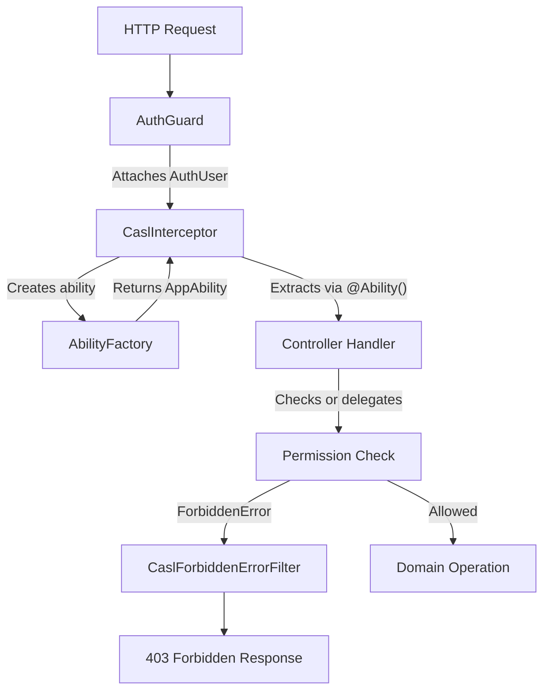

# Authorization with CASL Abilities

This document describes how the application authorizes requests using the [`@casl/ability`](../../package.json) library.

## Context

Protected operations depend on who the caller is and how they relate to the target resource. Defining permission rules across controllers and services duplicates policy logic and risks inconsistent enforcement. [`AbilityFactory`](../../src/casl/ability.factory.ts) centralizes permission rules in one place while controllers and services enforce them.

## Overview

When [`AuthGuard`](../../src/auth/auth.guard.ts) authenticates a request, [`CaslInterceptor`](../../src/casl/casl.interceptor.ts) uses [`AbilityFactory`](../../src/casl/ability.factory.ts) to build a request-scoped `AppAbility` for the authenticated user and attaches it to the request. Controller handlers extract this ability with [`@Ability()`](../../src/casl/ability.decorator.ts) and enforce permissions directly or delegate the check to a service. Failed checks throw `ForbiddenError`, which [`CaslForbiddenErrorFilter`](../../src/casl/casl-forbidden-error.filter.ts) converts into an HTTP `403 Forbidden` response.

## Building Blocks

### Request Attachment and Extraction

[`AuthGuard`](../../src/auth/auth.guard.ts) verifies the bearer token and stores the `AuthUser` on the request. [`CaslInterceptor`](../../src/casl/casl.interceptor.ts) runs globally on each request. When an `AuthUser` is present, the interceptor creates an `AppAbility` with [`AbilityFactory`](../../src/casl/ability.factory.ts) and attaches it to the request.

Controller handlers read the ability with the [`@Ability()`](../../src/casl/ability.decorator.ts) parameter decorator. If the request has no ability attached, [`@Ability()`](../../src/casl/ability.decorator.ts) throws `UnauthorizedException`.

### Permission Enforcement

Callers tag a resource object with the `subject()` helper from `@casl/ability`. They enforce permissions with `ForbiddenError.from(ability).throwUnlessCan(action, target)` or query `ability.can(action, target)` when they need a boolean check.

Checks run in one of two places depending on when the resource is loaded:

- **Controller check**: The controller builds or fetches the resource and checks the ability before returning data or changing state.
- **Service check**: When a service must load the resource first to verify that it exists or is valid, the controller passes `AppAbility` or an authorization callback for the service to run after loading the resource.

### Error Handling

[`CaslForbiddenErrorFilter`](../../src/casl/casl-forbidden-error.filter.ts) catches any unhandled `ForbiddenError` and returns an HTTP `403 Forbidden` JSON response instead of the default `500 Internal Server Error`.

## Related Docs

- [Subscription State](subscriptions.architecture.md): write and mutating operations require an active subscription, while read operations remain permitted without one
- [HATEOAS](hateoas.architecture.md): resource links describe navigation possibilities rather than permissions; the server enforces authorization when a client requests the linked destination
