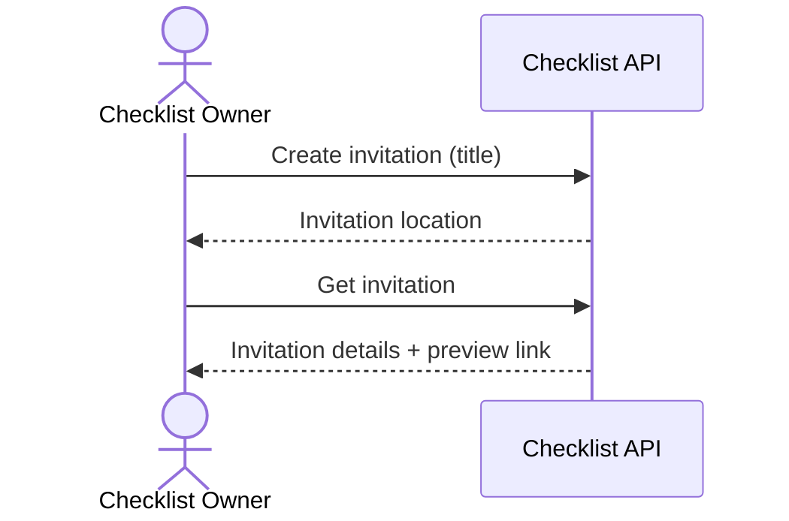
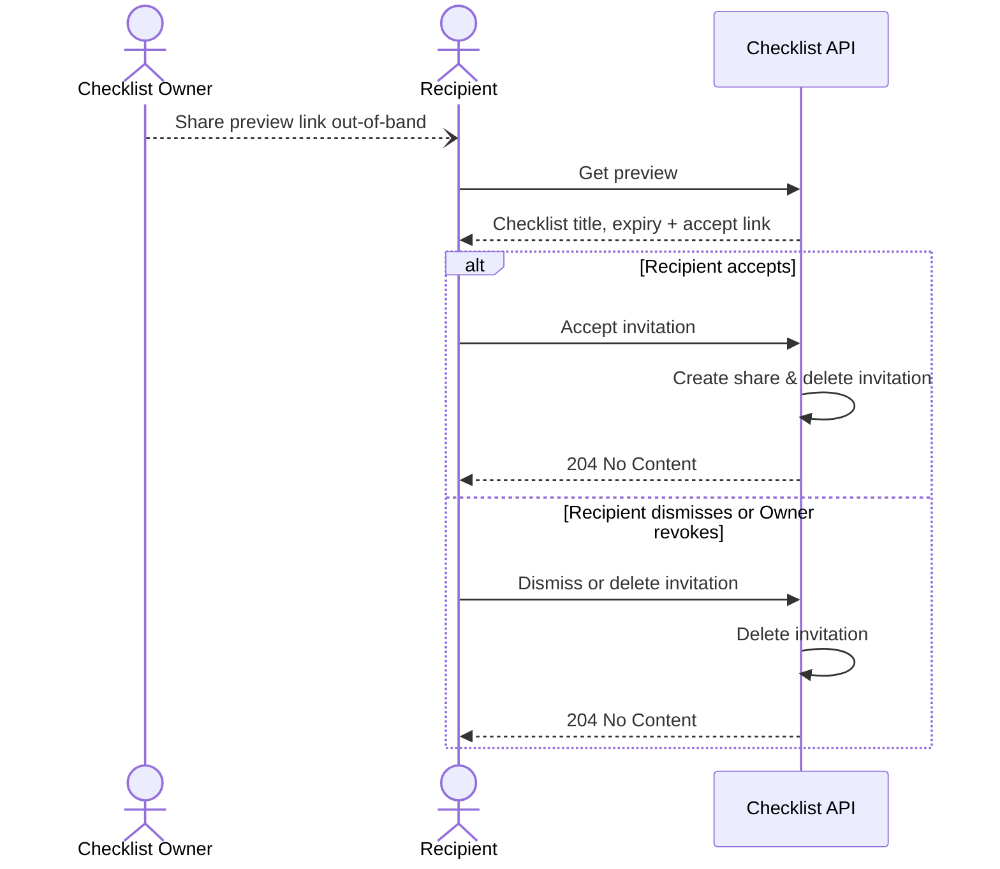

# Checklist Sharing: Invitation Flow

This document describes how the application shares checklists across users through token-based invitations.

## Context

Email-based invitations require the owner to know the recipient's registered email, tie acceptance to identity lookup, and force the application to send messages. Token-based invitations avoid these constraints. The invitation ID acts as a bearer token that the owner shares through any external channel, and any authenticated user can accept it.

## Overview

A checklist owner creates an invitation with a label (`title`) to track who the link is for. The system stores the invitation with a 24-hour expiration timestamp and returns a location for the new invitation resource. Recipients inspect the invitation preview and accept or dismiss it. Accepting a valid invitation creates a read-only share for the caller and deletes the invitation.

_Creating an invitation and retrieving its shareable link:_

_Sharing the link and accepting or rejecting the invitation:_

## Building Blocks

### Bearer-Token Invitations

Each invitation is a short-lived capability scoped to a single checklist. Its generated ID is the secret token, and its `title` is a private label for the owner. Invitations expire after 24 hours so unused links do not remain valid indefinitely.

### Owner and Recipient Views

The invitation resource separates owner management from recipient onboarding:

- **Owner view**: Exposes the private `title` and creation timestamp so the owner can track outstanding links, and links to the recipient preview while the invitation is active.
- **Recipient preview**: Exposes only the checklist title and expiration time, and surfaces the `accept` link only when the invitation is unexpired and the caller does not already have read access.

### Single-Use Exchange

Accepting an invitation exchanges the temporary token for a permanent share carrying the invitation's `title` and deletes the invitation. Because the invitation is deleted on acceptance, dismissal, or owner revocation, no separate status field is stored—any stored invitation is still pending.

## Related Docs

- [Authorization](authorization.architecture.md)
- [Checklist Share Invitation](../glossary/checklist-share-invitation.glossary.md)
