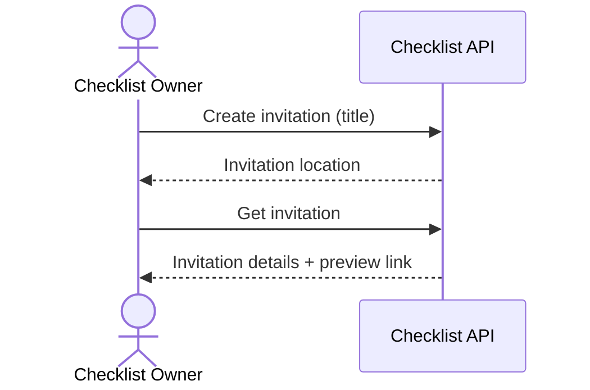
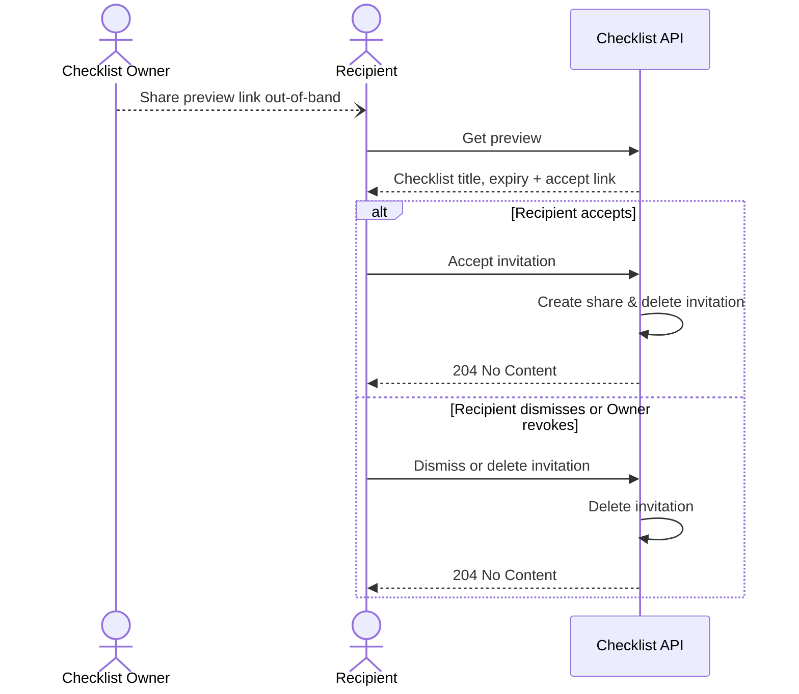

# Checklist Sharing: Invitation Flow

This document describes how the application shares checklists across users through token-based [checklist share invitations](../glossary/checklist-share-invitation.glossary.md).

## Context

Email-based sharing requires the owner to know the recipient's registered email. It also ties acceptance to identity lookup and forces the application to send messages. Token-based [checklist share invitations](../glossary/checklist-share-invitation.glossary.md) avoid these constraints. The checklist share invitation ID acts as a bearer token that the owner shares through any external channel, and any authenticated user can accept it.

## Overview

A checklist owner creates a [checklist share invitation](../glossary/checklist-share-invitation.glossary.md) with a `title` label to track the recipient. The system stores the checklist share invitation with a 24-hour expiration timestamp and returns its location. Recipients inspect the preview and accept or dismiss it. Accepting a valid checklist share invitation creates a read-only share for the caller and deletes the checklist share invitation.

_Creating a checklist share invitation and retrieving its shareable link:_

_Sharing the link and accepting or rejecting the checklist share invitation:_

## Building Blocks

### Bearer-Token Invitations

Each [checklist share invitation](../glossary/checklist-share-invitation.glossary.md) is a short-lived capability scoped to a single checklist. Its generated ID is the secret token, and its `title` is a private label for the owner. Checklist share invitations expire after 24 hours so unused links do not remain valid indefinitely.

### Owner and Recipient Views

The [checklist share invitation](../glossary/checklist-share-invitation.glossary.md) resource separates owner management from recipient onboarding:

- **Owner view**: Exposes the private `title` and creation timestamp so the owner can track outstanding links, and links to the recipient preview while the checklist share invitation is active.
- **Recipient preview**: Exposes only the checklist title and expiration time, and surfaces the `accept` link only when the checklist share invitation is unexpired and the caller does not already have read access.

### Single-Use Exchange

Accepting a [checklist share invitation](../glossary/checklist-share-invitation.glossary.md) exchanges the temporary token for a permanent share carrying the checklist share invitation's `title` and deletes the checklist share invitation. Because the checklist share invitation is deleted on acceptance, dismissal, or owner revocation, no separate status field is stored—any stored checklist share invitation is still pending.

## Related Docs

- [Checklist Share Invitation](../glossary/checklist-share-invitation.glossary.md)
- [Authorization](authorization.architecture.md)
- [HATEOAS](hateoas.architecture.md)
- [DELETE Idempotency](delete-idempotency.architecture.md)
- [Create Share Invitation](../stories/create-share-invitation.story.md)
- [Get Share Invitation](../stories/get-share-invitation.story.md)
- [View Received Invitation](../stories/view-received-invitation.story.md)
- [Accept Share Invitation](../stories/accept-share-invitation.story.md)
- [List Checklist Share Invitations](../stories/list-checklist-share-invitations.story.md)
- [Delete Share Invitation](../stories/delete-share-invitation.story.md)
- [Dismiss Checklist Share Invitation](../stories/dismiss-share-invitation.story.md)
