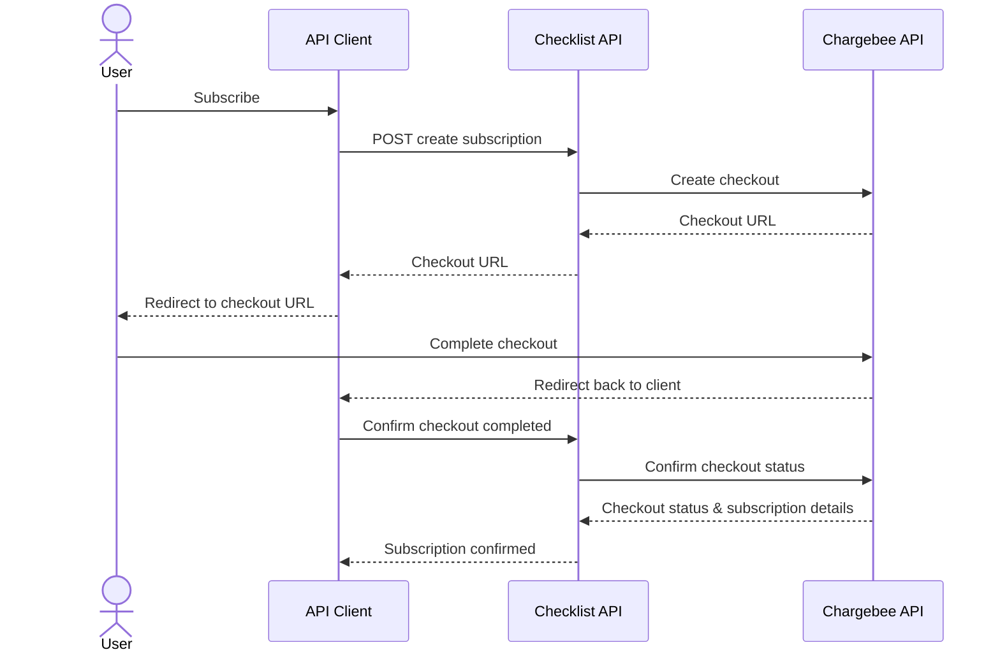

# Subscription State

This document describes the design for supporting subscriptions.

## Overview

A user's subscription entry is stored in Firebase. This is used as a cache for the underlying provider's state.

The API delegates subscription management to Chargebee. Subscription creation is driven by events from Chargebee that supply the user's subscription end date. The application derives the returned status, `ACTIVE` or `INACTIVE`, from the presence of that entry and whether its end date is after the current time. An active subscription grants the user access to write and mutating operations across the system, while read operations remain available regardless of subscription status.

## Rationale

Keeping subscription state in Firebase gives the application a shared, persisted source of truth associated with the user. Clients do not decide their own subscription state; instead, Chargebee events supply the authoritative validity end date.

Deriving status from the end date avoids storing two values that could contradict each other. It also avoids depending on a scheduled update to expire subscriptions on time. The trade-off is that status must be evaluated against the current time whenever subscription state is read or checked for authorization.

## Create Subscription Flow

Creating a subscription uses a Chargebee hosted checkout flow:

1. The client sends a `POST` request to the API to create a subscription.
2. The API calls the Chargebee API to create a checkout and returns the checkout URL to the client.
3. The client redirects the user to the checkout URL.
4. After completing the checkout, Chargebee redirects the user back to the client.
5. The client sends a request to the API to confirm that the checkout completed.
6. The API calls the Chargebee API to confirm the checkout status and records the subscription end date in Firebase.

## Behaviour and Invariants

- Subscription status is derived, never stored; the returned status is either `ACTIVE` or `INACTIVE`.
- If no subscription entry exists for the user, the returned status is `INACTIVE`.
- If an entry exists and its end date is strictly after the current time, the returned status is `ACTIVE`.
- If the end date is at or before the current time, the returned status is `INACTIVE`.
- Subscription creation is triggered by Chargebee events that contain the user's validity end date.
- Creating a subscription for a user who already has an `ACTIVE` subscription is rejected as a conflict.
- The end date represents the end of the known validity period, not a promise of renewal.
- Time comparisons use the application's trusted clock and compare absolute instants, independent of the user's time zone.
- A missing or invalid end date cannot establish an active subscription.
- Active subscription state includes the end of its known validity period. Inactive state has no end date and does not distinguish an absent entry from an expired entry or one with an unusable date.
- Reading subscription state does not mutate it; the passage of time can change whether it is currently active without changing the stored record.
- An absent subscription and a failure to retrieve subscription information remain distinct outcomes. Retrieval failure must not be presented as absence or establish an active subscription.
- Write and mutating operations require an `ACTIVE` subscription; read operations remain available when the user's subscription is `INACTIVE`.
- Current-user navigation resolves to the canonical user-owned resource through a redirect. Resolution requires authentication but no separate ownership check because the destination always belongs to the authenticated user. It does not retrieve subscription state; the canonical resource independently enforces authorization.

## Related Docs

- [Create Subscription](../stories/create-subscription.story.md)
- [View My Subscription](../stories/view-my-subscription.story.md)
- [Authorization](authorization.architecture.md)
- [HATEOAS](hateoas.architecture.md)
